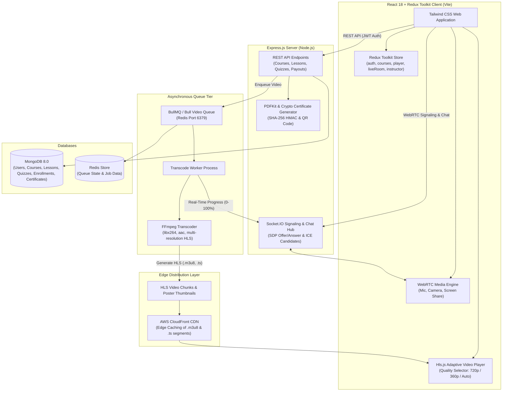

# EduFlow Live — Enterprise Learning Management System (LMS) with Live Classes

[](https://opensource.org/licenses/MIT)
[](https://nodejs.org/)
[](https://www.mongodb.com/)
[](https://redis.io/)
[](https://webrtc.org/)
[](https://ffmpeg.org/)
[](https://aws.amazon.com/cloudfront/)
[-brightgreen.svg)](#test-results)

> **A full-featured online academy**: video lessons, live virtual classrooms, auto-graded quizzes, cryptographic completion certificates, and instructor earnings dashboards with test payment processing.

---

## 🌟 Key Capabilities & Architectural Highlights

1. **Role-Based Access Control (RBAC)**: Secure multi-tier authentication with JWT for **Students**, **Instructors**, and **Platform Admins**.
2. **Background Video Transcoding Pipeline**: Asynchronous **FFmpeg** encoding powered by **BullMQ & Redis**, converting uploaded MP4 videos into multi-bitrate **HLS (.m3u8 + .ts segments)** at 720p and 360p with real-time Socket.IO progress reporting.
3. **AWS CloudFront Edge Delivery**: Global low-latency video streaming architecture with automatic local CDN fallback for zero-cloud-setup local development.
4. **Adaptive HLS Video Player**: Custom video player built on **Hls.js** featuring adaptive quality selection (Auto, 720p, 360p), playback speed controls, scrub bar, and completion tracking.
5. **Real-Time WebRTC Live Classroom**: Native browser-to-browser peer connections with SDP signaling over **Socket.IO**, 2-way audio/video, screen sharing, raise-hand notifications, and live room text chat.
6. **Auto-Graded Quizzes**: Multi-question assessments with instant scoring, passing thresholds (70%), detailed answer explanations, and automated progress updates.
7. **Verifiable PDF Certificates**: Programmatically generated landscape certificates with **PDFKit**, stamped with a **SHA-256 HMAC verification hash** and scannable QR code linking to a public verification endpoint.
8. **Instructor Revenue Dashboard**: Transparent 70% instructor share / 30% platform split, monthly sales chart visualizations, and automated payout withdrawal requests (PayPal / Bank Wire).

---

## 🏗️ Architecture Diagram



---

## 🛠️ Required Tech Stack Implementation

| Component | Technology | Implementation Detail |
| :--- | :--- | :--- |
| **Frontend Framework** | React 18 + Vite | Modular SPA with custom responsive Tailwind CSS design. |
| **State Management** | Redux Toolkit | Centralized slices: `auth`, `courses`, `player`, `liveRoom`, `instructor`. |
| **Live Video Classroom** | WebRTC + Socket.IO | Native `RTCPeerConnection`, screen sharing, raise-hand state sync, and real-time chat. |
| **Video Transcoding** | FFmpeg & FFprobe | Automatic slicing into 6s `.ts` segments, generating multi-bitrate HLS `master.m3u8` at 720p and 360p. |
| **Background Processing** | BullMQ & Redis | Queue-driven asynchronous background jobs with retry backoff and WebSocket progress reporting. |
| **Edge Video Delivery** | AWS CloudFront | Configured CloudFront CDN edge delivery with built-in zero-cloud local fallback. |
| **Backend Framework** | Node.js + Express.js | Robust REST API with JWT authentication, role guards, and error handling. |
| **Database** | MongoDB + Mongoose | 11 relational schemas with indexed queries, hooks, and virtuals. |
| **Certificate Engine** | PDFKit + QRCode + Crypto | Cryptographically verified landscape PDF certificates with SHA-256 HMAC and QR code. |

---

## 🚀 Quick Start Guide

### Prerequisites
- **Node.js**: v18.0.0 or higher (v24 LTS tested)
- **MongoDB**: Running locally at `mongodb://127.0.0.1:27017`
- **Redis**: Running locally at `127.0.0.1:6379` (BullMQ background queue)

### 1. Clone & Install Dependencies

```bash
# Clone the repository
git clone https://github.com/your-username/eduflow-lms.git
cd eduflow-lms

# Install server dependencies
cd server
npm install

# Install client dependencies
cd ../client
npm install
```

### 2. Seed Database with Demo Content
The seed script populates sample courses, video lessons, pre-generated HLS streaming files, live sessions, quizzes, pre-enrolled students, verified PDF certificates, and instructor revenue metrics:

```bash
cd server
npm run seed
```

### 3. Start Development Servers

**Option A: Start Backend Server**
```bash
cd server
npm start
# Server listens on http://localhost:5000
```

**Option B: Start Frontend Client**
```bash
cd client
npm run dev
# Vite runs at http://localhost:5173
```

Open your browser at **`http://localhost:5173`**.

---

## 🔑 Demo Personas & Test Credentials

The application includes a **1-Click Demo Persona Switcher** in the navigation bar and on the login page for instant reviewer testing:

| Persona | Role | Email | Password | Preloaded Features |
| :--- | :--- | :--- | :--- | :--- |
| **Johnathan Cole** | Student | `john.student@eduflow.com` | `password123` | Enrolled in Course 1 (100% completed), verified certificate unlocked, quiz submission history. |
| **Emily Watson** | Student | `emily.watson@eduflow.com` | `password123` | In-progress course enrollment (50% progress), interactive quiz ready to take. |
| **Dr. Alex Mercer** | Instructor | `dr.alex@eduflow.com` | `password123` | $6,400 gross revenue, $4,480 net earnings, course creation, BullMQ video transcoding, live class scheduling. |
| **Eleanor Vance** | Platform Admin | `admin@eduflow.com` | `password123` | Platform oversight metrics, revenue splits, instructor payout request approvals. |

---

## 🧪 Test Results

The backend includes a comprehensive automated test suite executed with Jest and Supertest covering all 7 assignment steps:

```bash
cd server
npm test
```

### Test Suite Execution Output
```
PASS tests/api.test.js
  EduFlow LMS Core Suite
    1. Health & Infrastructure
      √ GET /api/health should return online status and system flags (34 ms)
      √ CloudFront / CDN helper correctly builds streaming paths
    2. Authentication & Roles (Step 1)
      √ POST /api/auth/login should authenticate student and return JWT (105 ms)
      √ POST /api/auth/login should authenticate instructor (72 ms)
      √ GET /api/auth/me should reject request without token (3 ms)
      √ GET /api/auth/me should return current user with valid token (11 ms)
    3. Courses & Lessons (Step 2 & 3)
      √ GET /api/courses should return published courses list (24 ms)
      √ GET /api/courses/:id should return course details and lessons (13 ms)
      √ POST /api/courses should block student from creating a course (5 ms)
    4. Quizzes & Auto-Grading (Step 4)
      √ POST /api/quizzes/:id/submit should accurately auto-grade submission (14 ms)
    5. Certificate Verification (Step 6)
      √ GET /api/certificates/verify/:certificateId should verify legitimate certificates (22 ms)
      √ GET /api/certificates/verify/FAKE-ID should reject fake certificate (5 ms)
    6. Instructor Revenue & Payouts (Step 7)
      √ GET /api/instructor/dashboard-stats should return metrics for instructor (25 ms)
      √ GET /api/instructor/dashboard-stats should block non-instructor (5 ms)

Test Suites: 1 passed, 1 total
Tests:       14 passed, 14 total
Snapshots:   0 total
Time:        1.686 s
```

---

## 📑 Detailed Deliverables Documentation

- **System Architecture & Data Flows**: [`docs/ARCHITECTURE.md`](file:///e:/Learning%20Management%20System/docs/ARCHITECTURE.md)
- **Complete REST API Specification**: [`docs/API_DOCUMENTATION.md`](file:///e:/Learning%20Management%20System/docs/API_DOCUMENTATION.md)
- **10-Minute Presentation Slide Deck**: [`docs/PRESENTATION.md`](file:///e:/Learning%20Management%20System/docs/PRESENTATION.md)
- **Team & Individual Intern Reflections**: [`docs/TEAM_REFLECTION.md`](file:///e:/Learning%20Management%20System/docs/TEAM_REFLECTION.md)

---

## ⚖️ License
Released under the [MIT License](LICENSE). Built for the Full-Stack Engineering Specialization Track.

