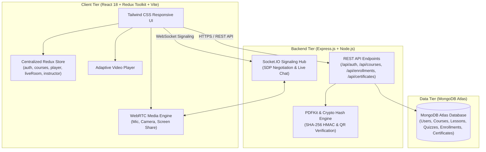

# EduFlow Academy — Full-Stack Learning Management System

[](https://eduflowacademy.vercel.app)
[](https://react.dev/)
[](https://nodejs.org/)
[](https://www.mongodb.com/)
[](https://webrtc.org/)
[](https://socket.io/)
[](https://tailwindcss.com/)
[](https://opensource.org/licenses/MIT)

> **EduFlow Academy** is a modern, production-grade Learning Management System (LMS) built with the MERN stack. It features real-time WebRTC virtual classrooms, adaptive video learning, automated curriculum assessments, cryptographic SHA-256 verifiable PDF certifications, and an instructor studio with monetization analytics.

---

## 🌐 Live Application

* **Production URL**: [https://eduflowacademy.vercel.app](https://eduflowacademy.vercel.app)
* **Monorepo Directory**: `FS-03/`

---

## ✨ Key Features & Capabilities

### 🎓 Student Experience
* **Course Catalog**: Filter by category, difficulty level, and sorting. Includes a mobile-responsive category dropdown and desktop chip filters.
* **Interactive Learning Player**: Track lesson completions, jump between modules, adjust playback speeds, and monitor course completion percentages in real time.
* **Auto-Graded Quizzes**: Multi-question assessments with instant scoring, passing thresholds, and answer explanations.
* **Student Dashboard**: Unified dashboard to track enrolled courses, resume active learning sessions, view completed masterclasses, and manage certificates.

### 👨‍🏫 Instructor Studio & Monetization
* **Dedicated Instructor Registration**: Seamless onboarding for educators with profile customization and expertise tagging.
* **Curriculum Management**: Create courses, organize modules, and upload video lessons.
* **Revenue Analytics**: Transparent earnings breakdown with net earnings tracking and withdrawal payout requests (PayPal / Bank Transfer).

### 🛡️ Platform Administration & Governance
* **Platform Metrics**: Overview of total platform revenue, instructor disbursements, student counts, and active courses.
* **Payout Management**: Review, approve, reject, or mark instructor withdrawal requests as settled with administrative audit notes.

### 📡 Real-Time WebRTC Live Classroom
* **Interactive Sessions**: Low-latency browser-to-browser peer connections with SDP signaling over Socket.IO.
* **Classroom Tools**: Live 2-way audio/video, real-time screen sharing, raise-hand participant notifications, and room-wide group chat.

### 📜 Cryptographic Verifiable Credentials
* **Digital PDF Certificates**: Generated programmatically with PDFKit upon 100% curriculum completion.
* **Tamper-Proof Verification**: Stamped with a cryptographic SHA-256 HMAC digital fingerprint and scannable QR code.
* **Public Verification Portal**: Accessible at `/verify-certificate/:certificateId` for instant verification by employers and academic institutions.

---

## 🏗️ System Architecture



---

## 🛠️ Tech Stack

| Layer | Technologies |
| :--- | :--- |
| **Frontend** | React 18, Vite, Redux Toolkit, Tailwind CSS, Lucide Icons, Axios |
| **Real-Time / Media** | WebSockets (Socket.IO), WebRTC, Hls.js |
| **Backend** | Node.js, Express.js, JWT, BcryptJS, Helmet, Morgan, Compression |
| **Database** | MongoDB Atlas, Mongoose ODM |
| **Credential Engine** | PDFKit, QRCode, Node.js Crypto (SHA-256 HMAC) |
| **Deployment** | Vercel (Client & Serverless API Routes) |

---

## 📁 Project Structure

```text
FS-03/
├── client/                     # Frontend React application (Vite)
│   ├── src/
│   │   ├── api/                # Axios instance & interceptors
│   │   ├── components/         # Reusable UI components (Navbar, Footer, Modals)
│   │   ├── features/           # Redux Toolkit slices (auth, courses, instructor)
│   │   ├── pages/              # Route pages (Home, Catalog, Learn, Dashboard, Verify)
│   │   ├── App.jsx             # Route definitions & protected routes
│   │   └── main.jsx            # React root with ErrorBoundary & Redux Provider
│   ├── package.json
│   └── vite.config.js
├── server/                     # Backend Express REST & WebSocket server
│   ├── config/                 # Database connection & cloud configurations
│   ├── controllers/            # Route controllers (auth, courses, certificates, admin)
│   ├── middleware/             # Auth guards (protect, authorize) & error handlers
│   ├── models/                 # Mongoose schemas (User, Course, Enrollment, Certificate)
│   ├── routes/                 # Express API routes
│   ├── services/               # Socket.IO signaling service & certificate generator
│   └── server.js               # Express application initialization & middleware
├── api/                        # Vercel serverless entry point
│   └── index.js
├── docs/                       # Architecture & API documentation
├── package.json                # Workspace monorepo root package
└── vercel.json                 # Vercel single-domain deployment configuration
```

---

## 🚀 Getting Started (Local Development)

### Prerequisites
* **Node.js**: v18.0.0 or higher
* **MongoDB**: A running MongoDB instance or MongoDB Atlas connection URI

### 1. Clone the Repository
```bash
git clone https://github.com/thomas2570/fullstack-internship-projects.git
cd fullstack-internship-projects/FS-03
```

### 2. Install Dependencies
```bash
npm run install:all
```
*(This installs root, client, and server dependencies in one command).*

### 3. Configure Environment Variables

Create a `.env` file in the `server` directory:

```env
PORT=5000
NODE_ENV=development
MONGO_URI=your_mongodb_connection_string
JWT_SECRET=your_jwt_secret_key
JWT_EXPIRES_IN=7d
CLIENT_URL=http://localhost:5173
```

### 4. Seed Initial Data (Optional)
Populate sample courses, video lessons, and verified demo certificates:
```bash
npm run seed
```

### 5. Start Development Servers
Run both frontend and backend concurrently:
```bash
npm run dev
```

* **Frontend client**: `http://localhost:5173`
* **Backend API**: `http://localhost:5000`

---

## 🧪 Testing

The backend includes automated integration tests covering authentication, course delivery, auto-grading, and certificate verification:

```bash
cd server
npm test
```

---

## 📑 Documentation

* **Architecture Specification**: [`docs/ARCHITECTURE.md`](docs/ARCHITECTURE.md)
* **REST API Endpoints**: [`docs/API_DOCUMENTATION.md`](docs/API_DOCUMENTATION.md)
* **Project Presentation**: [`docs/PRESENTATION.md`](docs/PRESENTATION.md)

---

## ⚖️ License

Distributed under the [MIT License](LICENSE). Built for the Full-Stack Engineering Internship Track.
