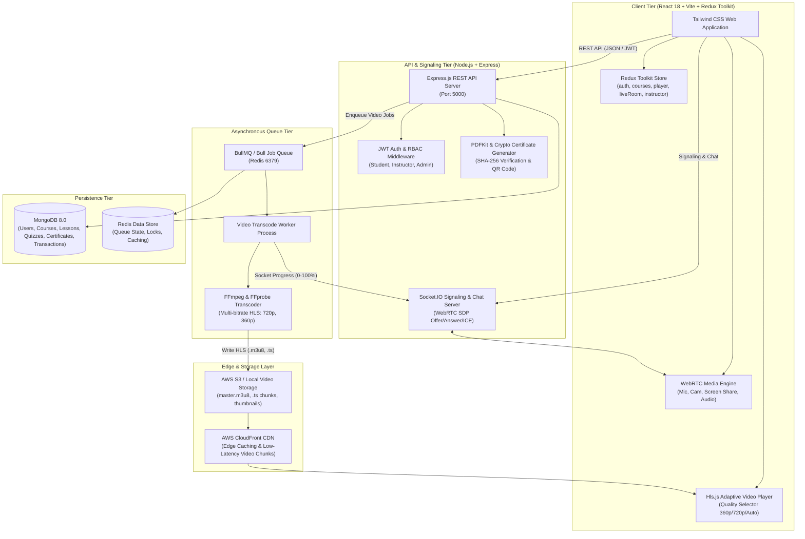
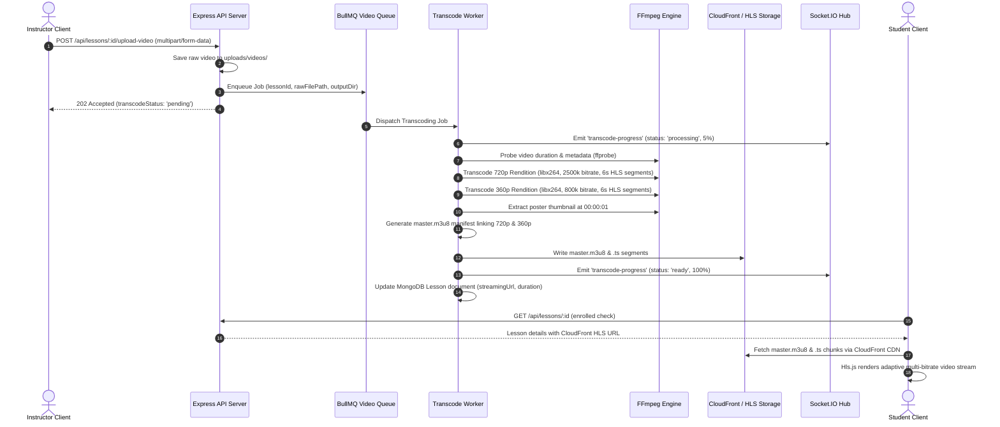
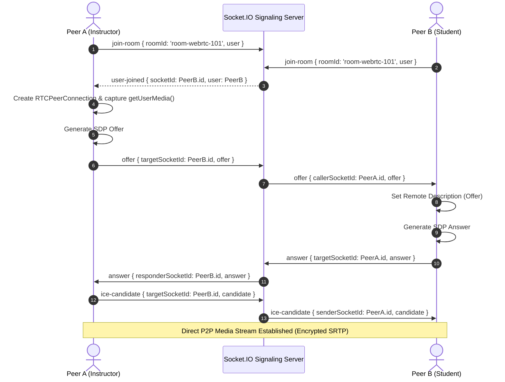
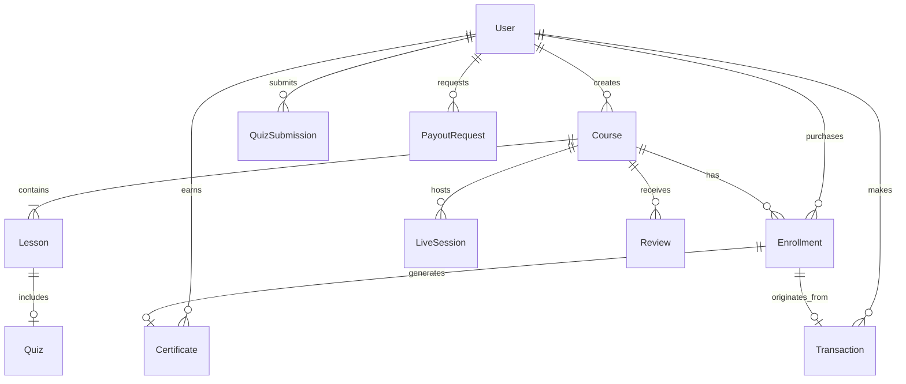

# EduFlow Live LMS: Full-Stack Architecture Documentation

## 1. High-Level System Architecture

EduFlow Live is an enterprise-grade Learning Management System engineered using the MERN stack with asynchronous media processing, WebRTC peer-to-peer streaming, and edge CDN distribution.

---

## 2. Media Processing & Delivery Pipeline

---

## 3. WebRTC Live Classroom Signaling Protocol

---

## 4. Database Schema Relationships

